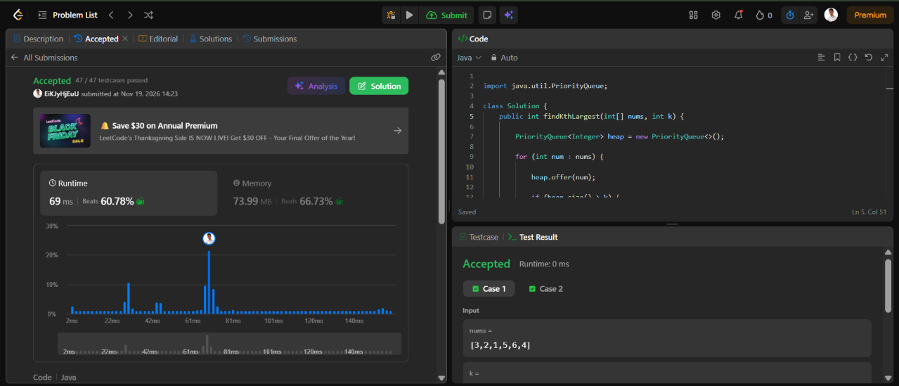
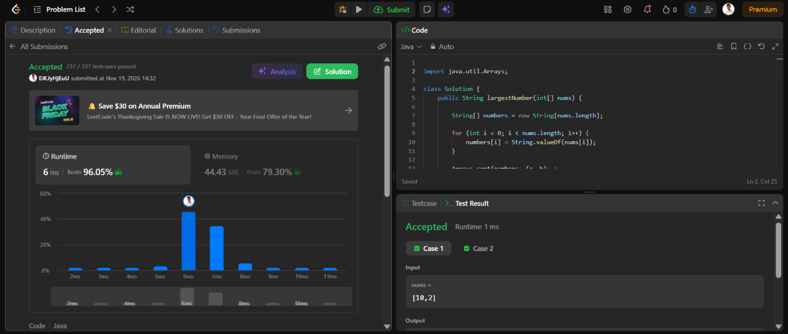
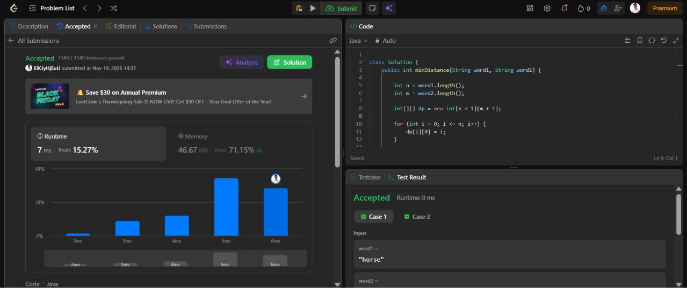

# Taller final — Análisis de algoritmos

Repositorio del grupo con los ocho ejercicios Medium de LeetCode. Cada ejercicio tiene su carpeta con el código, y las capturas de **Accepted** están en `evidencias/`.

## Autoría

| Integrante              | Ejercicios  |
| ----------------------- | ----------- |
| Santiago Varela Jimenez | 743, 1584   |
| Brayan                  | 215, 179, 72|
| Enrique                 | 300, 134, 79|

## 1. 215. Kth Largest Element in an Array

Enlace: https://leetcode.com/problems/kth-largest-element-in-an-array/  
Lenguaje: Java  
Código: [`kth-largest/Solution.java`](kth-largest/Solution.java)  
Familia: montículos (heap)

**Idea:** se mantiene una cola de prioridad mínima con los `k` elementos más grandes encontrados hasta el momento. Al recorrer cada número, se agrega al montón y, si este supera un tamaño de `k`, se elimina el menor elemento con `poll()`. Al final, la raíz del montón contiene el k-ésimo elemento más grande.

**Complejidad:** con `n` elementos, el tiempo es **O(n log k)** y el espacio es **O(k)**.

## 2. 179. Largest Number

Enlace: https://leetcode.com/problems/largest-number/  
Lenguaje: Java  
Código: [`largest-number/Solution.java`](largest-number/Solution.java)  
Familia: ordenamiento

**Idea:** se convierten los números a cadenas y se ordenan con un comparador personalizado. Para dos cadenas `a` y `b`, se compara `b + a` contra `a + b`, de modo que quede primero la combinación que produce el número mayor. Después se concatenan las cadenas en el orden obtenido; si el primer resultado es `"0"`, se devuelve `"0"` para evitar respuestas como `"000"`.

**Complejidad:** con `n` números, el tiempo es **O(n log n)** por el ordenamiento y el espacio es **O(n)** para las cadenas.

## 3. 743. Network Delay Time

Enlace: https://leetcode.com/problems/network-delay-time/  
Lenguaje: Java  
Código: [`network-delay-time/Solution.java`](network-delay-time/Solution.java)  
Familia: grafos (Dijkstra)

**Idea:** la red es un grafo dirigido donde cada arco tiene un tiempo. Como los tiempos no son todos iguales, un BFS no sirve (no es lo mismo un arco de 1 que uno de 100). Se usa Dijkstra desde el nodo `k`: una cola de prioridad que siempre saca el nodo al que se llega en menos tiempo acumulado, y desde ahí se actualizan sus vecinos si se encuentra un camino más corto. Cuando la cola se vacía, la señal ya llegó a todos los nodos alcanzables; la respuesta es el tiempo del más lejano, o `-1` si algún nodo nunca recibió la señal.

**Complejidad:** con `n` nodos y `m = times.length` arcos, el tiempo es **O((n + m) log n)** y el espacio es **O(n + m)** (lista de adyacencia, arreglo de distancias y cola).

## 4. 1584. Min Cost to Connect All Points

Enlace: https://leetcode.com/problems/min-cost-to-connect-all-points/  
Lenguaje: Java  
Código: [`min-cost-to-connect-all-points/Solution.java`](min-cost-to-connect-all-points/Solution.java)  
Familia: grafos (árbol de recubrimiento mínimo)

**Idea:** los puntos son vértices de un grafo completo y el peso de cada arista es la distancia de Manhattan entre sus extremos. No hay un origen: se busca conectar a todos gastando lo menos posible, o sea, un árbol de recubrimiento mínimo. Se resuelve con Prim: se empieza en un punto, y en cada vuelta se agrega al grupo el punto desconectado que sale más barato de unir; después se revisa si ese punto nuevo abarata la conexión de los demás. Se usa Prim con arreglo (sin cola) porque el grafo es completo y así queda más simple.

**Complejidad:** con `n = points.length`, el tiempo es **O(n²)** (n vueltas, y en cada una se recorre el arreglo dos veces) y el espacio es **O(n)** (arreglos `costo` y `conectado`).

## 5. 72. Edit Distance

Enlace: https://leetcode.com/problems/edit-distance/  
Lenguaje: Java  
Código: [`edit-distance/Solution.java`](edit-distance/Solution.java)  
Familia: programación dinámica

**Idea:** se construye una tabla `dp` donde `dp[i][j]` representa el número mínimo de operaciones para convertir los primeros `i` caracteres de `word1` en los primeros `j` caracteres de `word2`. Las primeras fila y columna representan convertir una cadena vacía en la otra. Si los caracteres coinciden, se conserva el resultado anterior; si no coinciden, se toma el menor costo entre eliminar, insertar o reemplazar un carácter y se suma 1.

**Complejidad:** con longitudes `n` y `m`, el tiempo es **O(n × m)** y el espacio es **O(n × m)** por la tabla de programación dinámica.

## 6. 300. Longest Increasing Subsequence

Pendiente

## 7. 134. Gas Station

Pendiente

## 8. 79. Word Search

Pendiente
